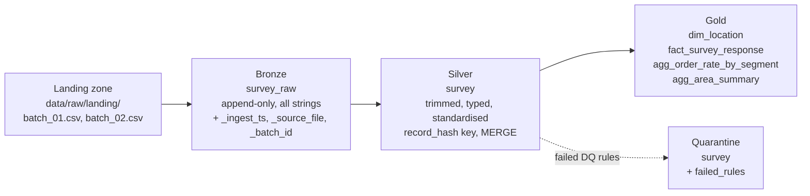

# Food Delivery Lakehouse

A local **PySpark + Delta Lake** pipeline that takes a raw food-delivery survey CSV through
**Bronze → Silver → Gold** layers. Raw files land untouched, get cleaned, validated against 13 data
quality rules and de-duplicated, and end up as a small star schema and business tables that answer
"which customers order again, and why?". Every stage is **idempotent**, covered by **29 unit tests**,
and reconciled by a quality report that accounts for every row.

> **About scale:** the dataset has 388 rows, which pandas could handle easily. The point of the
> project is pipeline design: layering, explicit schemas, data quality, idempotent incremental loads,
> testing and reconciliation. The same code runs unchanged on far larger data.

## Architecture



| Layer | Table(s) | Rows | Rule |
|---|---|---|---|
| Bronze | `survey_raw` | 388 | Raw values as they arrived, plus lineage. Append-only; a file is never loaded twice. |
| Quarantine | `survey` | 0 | Rows failing any DQ rule, with the names of the rules they broke. |
| Silver | `survey` | 285 | Cleaned, typed, one row per distinct respondent (`record_hash`). Loaded with `MERGE`. |
| Gold | `dim_location`, `fact_survey_response` | 77, 285 | Star schema, rebuilt from Silver on every run. |
| Gold | `agg_order_rate_by_segment`, `agg_area_summary` | 26, 77 | Pre-computed rates with sample sizes and a small-sample flag. |

**Reconciliation:** Bronze 388 = Silver 285 + 103 duplicates + 0 quarantined
([`notebooks/04_quality_report.ipynb`](notebooks/04_quality_report.ipynb), 12 of 12 checks pass).

## Tech stack

PySpark 3.5 · Delta Lake 3.3 · Python 3.12 · pytest + chispa · PyYAML · Jupyter notebooks in VS Code

## How to run

**Prerequisites**
- Python **3.10–3.12** (PySpark 3.5 does not support 3.13)
- Java 17 (for example Eclipse Temurin), with `JAVA_HOME` set
- Internet access on the first run, to download the Delta Lake JARs
- **Windows only:** Spark needs `winutils.exe` and `hadoop.dll` (Hadoop 3.3.x builds) in
  `C:\hadoop\bin`, with `HADOOP_HOME=C:\hadoop` and `C:\hadoop\bin` on `PATH`. This is a local
  Windows workaround; on Linux, macOS and cloud Spark it isn't needed.

**Install**
```bash
git clone https://github.com/KunalPS98/food-delivery-lakehouse.git
cd food-delivery-lakehouse
python -m venv .venv
.venv\Scripts\activate          # macOS/Linux: source .venv/bin/activate
pip install -r requirements-dev.txt
pip install -e .
```

**Run the pipeline** (landing → Bronze → Silver → Gold, settings in [`config/pipeline.yaml`](config/pipeline.yaml))
```bash
python -m food_pipeline.run_pipeline
```
Running it again changes nothing: Bronze skips files it has already loaded, Silver's `MERGE` inserts
no existing `record_hash`, and Gold is rebuilt to the same result.

**Run the tests**
```bash
python -m pytest -v
```

**Explore step by step:** the notebooks in [`notebooks/`](notebooks) walk through each layer in
order: `00_explore` → `01_bronze_ingest` → `02_silver_transform` → `03_gold_model` → `04_quality_report`.

## Repository structure

```
├── config/pipeline.yaml          # paths, Spark settings, DQ threshold
├── data/raw/
│   ├── online_food_delivery.csv  # original Kaggle file
│   └── landing/                  # batch_01.csv, batch_02.csv (simulated arrivals)
├── docs/
│   ├── data_dictionary.md        # every column in every table
│   └── decisions.md              # design decisions and their trade-offs
├── notebooks/                    # exploration and walkthroughs, one per layer
├── scripts/make_landing_batches.py
├── src/food_pipeline/
│   ├── spark_session.py          # get_spark() with Delta configured
│   ├── config.py                 # loads pipeline.yaml
│   ├── schemas.py                # explicit raw schema
│   ├── bronze.py                 # ingestion with batch guard
│   ├── silver.py                 # pure cleaning functions, record_hash, MERGE
│   ├── quality.py                # DQ rules and quarantine
│   ├── gold.py                   # star schema and aggregates
│   └── run_pipeline.py           # one-command end-to-end run
└── tests/                        # pytest + chispa, 29 tests
```

## Data issues found, and how each is handled

Profiled in [`notebooks/00_explore.ipynb`](notebooks/00_explore.ipynb).

| Issue | Evidence | Handling |
|---|---|---|
| Unnamed 14th column | The header ends with a comma; the extra column equals `Output` in all 388 rows | Kept in Bronze as `raw_extra`; a DQ rule proves it matches, then Silver drops it |
| Exact duplicates | 388 rows, 285 distinct; no respondent ID | Kept in Bronze; Silver de-duplicates on `record_hash` ([decision](docs/decisions.md)) |
| Trailing whitespace | All 71 `Negative` values are stored as `"Negative "` | `trim()` on every string column |
| Spelling and labels | `Self Employeed` (54), `House wife` (9) | Mapped to `Self Employed`, `Homemaker` |
| Income as text bands | Bands sort alphabetically (`10001 to 25000` < `No Income`) | `income_band_order` 0–4 plus `income_min_inr` / `income_max_inr` |
| Everything read as text | Numbers, coordinates and IDs all strings | `age`, `family_size` → int; `latitude`, `longitude` → double; `pin_code` stays a string (it's an ID) |
| Ambiguous `Output` | Yes/No with no definition | Renamed to boolean `ordered_again` (assumption: *would order again*) |
| Column names with spaces | `Marital Status`, `Pin code`; Delta rejects spaces | snake_case names applied by position in the Bronze schema |
| No timestamps | A one-off survey snapshot | Split into two landing batches to practise incremental loads (simulated) |

## Data quality

13 rules in [`quality.py`](src/food_pipeline/quality.py): age 18–80, family size 1–15, pin code
`560xxx`, coordinates inside Bengaluru, known income band, known outcome, `raw_extra` matches
`ordered_again`, and allowed values for gender, marital status, occupation, customer type and feedback.

- A row failing any rule goes to quarantine with every rule it broke; it is never silently dropped.
- A condition that evaluates to null (for example a missing age) counts as a **failure**, not a pass.
- If a batch quarantines more than 5% of its rows, the run stops before Silver, because that usually
  means the source is broken.
- On this data all 13 rules pass. Unit tests and injected bad rows prove each rule can fail.

## Results

From 285 de-duplicated respondents (overall order-again rate **0.761**). These are associations from a
survey sample, not causes; the full table is in [`notebooks/03_gold_model.ipynb`](notebooks/03_gold_model.ipynb).

1. **Feedback is the strongest signal:** respondents with positive feedback order again at 0.874 (n=231), with negative feedback at 0.278 (n=54).
2. **Students order again most, earners least:** students 0.875 (n=144) vs employees 0.638 (n=94) and self-employed 0.632 (n=38). Income shows the same split, and the two overlap (students have no income), so their effects can't be separated here.
3. **Ages 27–30 are the weakest segment:** 0.465 (n=43), against 0.886 for ages 18–22 (n=70).
4. **Married respondents order again less:** 0.609 (n=87) vs 0.847 for single respondents (n=189).
5. **Areas can't be compared yet:** 76 of 77 pin codes have fewer than 20 respondents.

## Limitations

- **Small survey, not transactions.** 388 responses from one city, skewed young (ages 18–33) and towards students.
- **Simulated batches.** The single source file is split into two landing files to exercise incremental loading.
- **De-duplication trade-off.** With no respondent ID, two people who gave identical answers are merged into one Silver row ([details](docs/decisions.md)).
- **Assumed meaning of `Output`.** It is interpreted as "would order again"; the source doesn't define it.
- **Single-writer assumption.** The Bronze batch guard checks, then writes; two runs at the same moment could both pass the check. One scheduled run at a time avoids this.
- **Local only.** Runs in Spark local mode; the code itself has no local-only dependencies apart from the Windows Hadoop helpers.

## Data source

[Online Food Ordering Dataset](https://www.kaggle.com/datasets/srisyra02/online-food-ordering-dataset) on Kaggle:
a survey of online food ordering customers in Bengaluru, India. The dataset is free to use under its
Kaggle licence; see the dataset page for the terms.

## Documentation

- [Data dictionary](docs/data_dictionary.md): every column in Bronze, Silver, Quarantine and Gold
- [Design decisions](docs/decisions.md): what was decided, why, and the trade-offs
